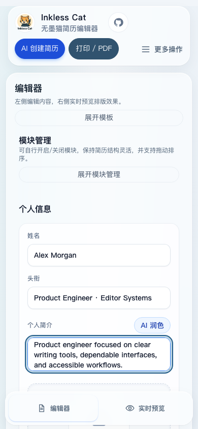
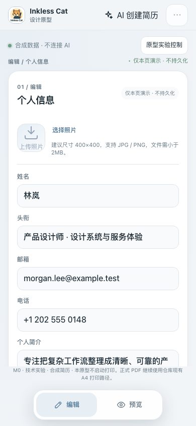
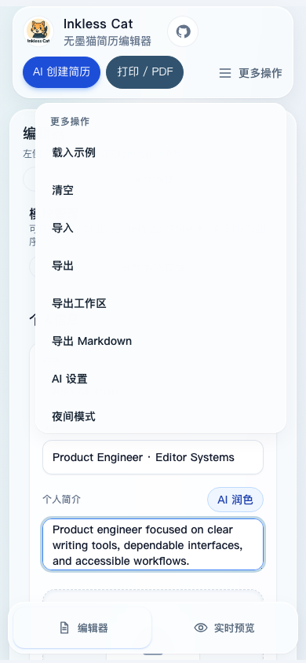
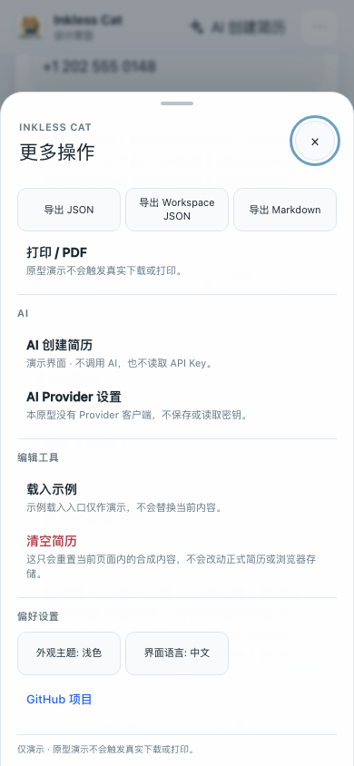

# Mobile Compact Studio 2.0 · M0 设计与可行性报告

状态：设计评审稿。M0 原型使用合成数据；没有合并或改写生产编辑器。PR #17 仍是只读参考。

## 范围与证据

- M0 基线：远程 `main` `7eac5487caf25610f5edcaf87524027595cfc754`。PR #17 当前为 Draft，head `91a86df78af12666b5bdfd1ba6eb230d1660a195`，Cloudflare Preview：[8e2aeec3.inkless-cat.pages.dev](https://8e2aeec3.inkless-cat.pages.dev/)。远程分支和 PR 状态在创建 M0 分支前重新读取。
- M0 原型入口：`/design/mobile-compact`，在 `src/main.tsx` 中独立懒加载。`/` 继续渲染 `App`。
- 源码审计覆盖主分支、PR #17 的编辑器壳层、Preview 页面、模块与模板组件、移动端 Hook、打印样式和 E2E。PR #17 尚未合并的文件以其 head SHA 读取，不把它们当作 main 现状。
- 视觉证据来自 PR #17 Preview 的 DOM/视口测量、当前 M0 本地原型的浏览器测量，以及 M0 Playwright 几何和截图产物。用户提到的 iPhone 实机截图未附在本任务中，标记为 Pending。
- 原生 iPhone Safari、软键盘、地址栏、Dynamic Island 和 VoiceOver 尚未实测。Playwright Chromium/Firefox 不能代替原生设备结论。

## A. 产品 UX 审计

### 依赖关系与兼容性

PR #17 实际依赖关系：

```text
EditorPage
└── EditorPageShell
    └── useEditorPageController
        └── ProductionStudioShell
            ├── Topbar
            ├── EditorSidebarPane
            │   ├── ModulesPanel / SectionManager
            │   └── TemplateSelector
            ├── EditorPreviewPane
            │   └── ResumePreview → ResumePreviewView
            └── MobileSwitcherBar
```

| 层                                                                   | M1～M3 可复用方式                                                      | 必须保护的边界                                                                                                                 |
| -------------------------------------------------------------------- | ---------------------------------------------------------------------- | ------------------------------------------------------------------------------------------------------------------------------ |
| `EditorPageShell`、`useEditorPageController`、`ProductionStudioShell` | 保留为正式装配和业务控制层                                             | 不复制导入、导出、打印、AI、存储或撤销回调                                                                                     |
| `Topbar` / `ActionButtons`                                           | 复用正式 action callbacks；新增紧凑展示层，只把低频项移入 Action Sheet | AI、文件、主题、语言、清空等仍走原有 controller                                                                                |
| `MobileSwitcherBar`、`useMobileLayout`、`useMobileSwitcher`          | 可改为两项 Floating Dock 的视觉与布局                                  | 唯一状态由 `setMobileView` 设置为 `editor` 或 `preview`；断点切换仍服从现有布局 Hook                                          |
| `EditorSidebarPane`、`SectionManager` / ModulesPanel                 | 增加移动入口或展示适配；保留原组件与排序机制                           | 显隐、拖动、键盘排序、Undo、自定义模块和跳转继续走现有业务状态                                                                 |
| `TemplateSelector`                                                   | 保留完整模板选择、创建、编辑和删除流程；移动端按需展开                 | built-in/custom 模板由 controller 提供；删除确认和当前模板回退不复制实现                                                       |
| `ResumePreview` / `ResumePreviewView`                                | 复用正式渲染器，在 `EditorPreviewPane` 周围实验容器                    | 不改正式渲染组件或 print CSS；变换后的滚动坐标需专门适配                                                                       |
| `PhotoUpload`                                                        | 保留正式文件输入和 `@shared/lib/limits` 校验；仅调整手机展示           | 文件类型、大小、宽高、像素和数据 URL 处理不变                                                                                  |
| `StudioDialog` / `StudioPopover`                                     | Dialog 可复用正式回调；Action Sheet 需有独立的移动展示容器             | Popover 不是模态对话框；要验证 Tab 行为，避免 Action Sheet 与子 Dialog 双重陷阱                                                |
| `useScrollSync`                                                      | controller 不重写；先确认容器和几何是否一致                            | 它依赖 section 的 `offsetTop` / `offsetHeight` 与视口位置，scale transform 会改变 `getBoundingClientRect()` 却不改变 offset 值 |

`ui.store.tsx` 中 `mobileView` 初值为 `editor`，`templatePanelOpen` 与 `modulePanelOpen` 互斥；重复调用 toggle 会收起当前面板。`partialize` 只持久化主题、模板 ID 与自定义模板，面板开合和移动视图不会持久化。`useMobileLayout` 在宽屏切换到编辑视图。M1 必须沿用这些状态，不可另建生产移动模式 Store。

### 现状几何与问题清单

PR #17 Preview，普通字号，DOM CSS 几何（来源：实际浏览器测量）：

| 视口    |        现有 Topbar |         现有 Dock | 用户影响                               |
| ------- | -----------------: | ----------------: | -------------------------------------- |
| 320×844 |  x=8，w=304，h=167 |  x=8，w=304，h=66 | 顶部多行；320×568 首屏没有真实编辑字段 |
| 360×844 |  x=8，w=344，h=117 |  x=8，w=344，h=66 | 顶部操作区仍占约 14% 高度              |
| 390×844 | x=16，w=358，h=117 | x=10，w=370，h=66 | Dock 接近全屏宽；顶栏多行              |
| 430×844 | x=16，w=398，h=117 | x=10，w=410，h=66 | Dock 仍接近全屏宽                      |

Topbar 使用 sticky；页面滚动后没有紧凑折叠，仍占 117px（320px 窄屏为 167px）。在 320×568，用户先看到导航与较大的照片区域，输入字段需要向下滚动。320px 时照片格约 220×270px。操作 Popover 在 320px 高度的内容滚动高度约 479px，可视区域约 280px；长菜单能滚动，但没有清晰的触屏分组和稳定的焦点边界。Dock 与 Safari 底部工具栏叠加时的原生行为未验证。

| 优先级 / 区域           | 用户影响与证据                                                                       | M0 建议                                                                         | 阶段                             |
| ----------------------- | ------------------------------------------------------------------------------------ | ------------------------------------------------------------------------------- | -------------------------------- |
| P1 顶栏                 | 320～430px 高 117～167px；低频打印、导入导出常驻，挤压简历字段；滚动后不收起         | 56～64px 单行 Compact Header；AI 与更多操作常驻，低频项入 Sheet；不以小字换单行 | M0 定稿、M1 实现                 |
| P1 Dock / 键盘          | 390px Dock 宽 370、高 66；真实 iPhone 键盘、地址栏未知；`index.html` 未声明 `viewport-fit=cover` | 220～270px 双模式胶囊；先验证 viewport meta 与 safe-area，再处理键盘/视觉视口状态 | M0 验证、M1 实现；iPhone Pending |
| P1 操作菜单             | 长 Popover 在 320px 需要滚动；`StudioPopover` 没有 modal Focus Trap 契约             | 分类 Action Sheet；Escape、遮罩、重复触发、Tab 循环、文件选择器和 Dialog 交接   | M0 定稿、M1 实现                 |
| P2 编辑密度             | 多层外壳、卡片与字段容器首屏占高；照片 tile 过大；字段间需长距离滚动                 | 当前模块和保存状态紧凑呈现；16px 输入；56px 紧凑头像；移除重复标题              | M0 定稿、M2 实现                 |
| P2 模板入口             | 完整选择面板展开会打断编辑并占据纵向空间；面板开合不持久化                           | 当前模板摘要 + “查看全部”按需进入；返回原滚动位置和焦点                         | M0 定稿、M2 实现                 |
| P2 模块入口             | 管理列表是高频管理任务与编辑任务的切换点；错误地本地重做会绕开 Undo/键盘排序         | 入口显式显示模块数量；复用 `SectionManager` 和原有排序回调                      | M0 定稿、M2 实现                 |
| P2 预览                 | 手机看到的是响应式简历 DOM；目前缺少纸张边界和清楚的阅读容器，标题/工具栏占垂直空间  | 先采用响应式内容 + 纸张框架；固定纸宽实验不得冒充打印所见即所得                 | M0 已验证候选、M3 决策           |
| P2 Sticky / 滚动同步    | 固定导航挤占可见区域；缩放时 section 的布局 offset 与视觉矩形不一致                  | M1 记录真实 `visualViewport`；M3 对缩放容器加入几何适配，不重写 controller      | M1/M3                            |
| P3 主题、语言与辅助入口 | 状态有多处入口时难以预期；GitHub 对编辑不属高频                                      | 在偏好分组提供主题、语言与项目入口；沿用 Token，低频入口移出顶栏                | M0 定稿、M1 实现                 |

没有发现必须阻断 M0 的 P0；桌面工作区和正式打印在当前 M0 变更范围内未改动。原生 iPhone 结果仍是 P1 Pending。

### M0 编辑首屏几何

M0 原型 DOM 测量，正常字号：

| 视口         | Header | Main                   | 编辑卡片                  | 首屏输入字段 |                Dock | 横向溢出 |
| ------------ | -----: | ---------------------- | ------------------------- | -----------: | ------------------: | -------: |
| 320×568      |   60px | y=60～450              | x=12，w=296               |            2 |   x=31，w=258，h=60 |      0px |
| 320×844      |   60px | y=60～726              | x=12，w=296               |            5 |   x=31，w=258，h=60 |      0px |
| 360×800      |   60px | y=60～682              | x=12，w=336               |            5 |   x=51，w=258，h=60 |      0px |
| 390×844      |   60px | y=60～726              | x=16，w=358               |            5 |   x=66，w=258，h=60 |      0px |
| 393×852      |   60px | y=60～734              | x=16，w=361               |            5 | x=67.5，w=258，h=60 |      0px |
| 430×932      |   60px | y=60～814              | x=16，w=398               |            5 |   x=86，w=258，h=60 |      0px |
| 768×1024     |   60px | y=60～921              | x=20，w=728               |            6 |  x=255，w=258，h=60 |      0px |
| 844×390 横屏 |   54px | y=54～287              | 两个姓名/头衔输入完整可见 |            2 |         y=318，h=60 |      0px |
| 1024×768     |   60px | y=60～1204，页面可滚动 | x=148，w=728              |            5 |  x=383，w=258，h=60 |      0px |
| 1440×900     |   60px | y=60～1204，页面可滚动 | x=356，w=728              |            6 |  x=591，w=258，h=60 |      0px |

390px 左右留白各 16px，误差 0px；320px 左右留白各 12px，误差 0px。Dock 与编辑区之间至少留 31px；普通竖屏 Main 保留 46px 间隔。横屏首屏曾经看不到输入字段，M0 将实验工具与重复上下文收起，并把标题压成单行；当前姓名、头衔输入完整位于 Main 内，Dock 不盖住它们。CI 会断言这一点。

150%/200% 字号允许 Header 按内容增高：390×844 时 150% Header 约 110px，200% 约 130px；320×568、200% Header 约 120px。两种字体放大下文档宽度不超过视口，Dock 两个按钮各不小于 44×44px。这个设计明确允许换行，不会强行维持单行。

## B. 设计系统规范

### Compact Header

- 正常字号 60px；叠加 `env(safe-area-inset-top)`，不使用大型玻璃容器。横屏压缩到 54px。普通状态保持一行：现有品牌图标和 Inkless Cat，右侧 AI 快捷入口与更多操作。AI 入口打开同一个 Action Sheet 并聚焦“AI 创建简历”；演示操作关闭 Sheet 并提示未连接 AI。
- 320px 时 AI 入口收为带可访问名称的 44px 图标按钮；320/360/390/430px 不缩小主要触控区。
- 背景使用冷灰与低透明度柔玻璃；滚动中不做高度切换，避免 sticky 跳动。字号放大时自然换行和增高。

### Compact Editor

- 主背景 `#f2f5f8`，单层白色编辑面；蓝灰 `#547b9a` 表示可操作/选中，边框 `#dfe6eb`。字段和正式简历纸张采用不透明表面。
- 标签在输入上方；输入正文按 16px；左右间距成对；长文本 textarea 保留足够行数。保存状态靠近当前模块，不重复展示整页标题。
- 头像预览 56×56px；M0 复用正式 `PhotoUpload`，保留类型、大小、像素、尺寸和 Data URL 校验。照片只写入原型的局部合成状态，不写 Workspace 或持久化 Store。
- 表单、照片、模块入口都复用原有正式业务组件或真实展示组件；M0 页面仅用局部合成状态演示。

### Floating Dock

- 只保留“编辑”和“预览”。默认宽 258px、高 60px、底部 12px + safe area；主按钮最小 48px 高，页面级触控验收阈值 44×44px。
- 选中项使用浅蓝灰底和清晰字色，不用重阴影。输入键盘出现时隐藏或避让，恢复时不改变 `mobileView`。
- 正式 M1 必须连接现有 `setMobileView`。M0 由于数据隔离使用本地状态作交互原型，不能把它复制进生产。

### Mobile Action Sheet

- 从 Header 更多按钮打开；原生 `<dialog>.showModal()`，底部圆角面板，最大 88dvh，内容区独立滚动。横屏最大 96dvh。
- 分组：文件（导入、三种导出、打印/PDF）；AI（创建、Provider 设置）；编辑工具（示例、清空）；偏好（主题、语言、GitHub）。菜单常规动作高度至少 48px，链接至少 44px。
- 背景轻遮罩；只在导航和浮层使用玻璃。Reduced Transparency 时关闭 blur。
- 原生 modal 打开时，底下的触发器不可交互；再次点它的屏幕位置会命中遮罩并关闭。关闭按钮与 Escape 也可用；Tab/Shift+Tab 在 Sheet 内循环，关闭后焦点返回触发器。

### 模板与模块入口

- 编辑首屏显示当前模板名和“查看全部模板”；模块显示已启用计数。完整管理按需进入，不在编辑首屏展开。
- M0 通过正式 `TemplateSelector`、`SectionManager` 的展示与交互验证，但传入合成样例和本地回调。模板切换影响合成预览；创建、编辑、删除只动本页合成模板。
- 生产返回时恢复打开入口的滚动上下文与焦点；模块操作必须保留互斥、重复点击收起、隐藏模块 Undo、键盘排序和自定义模块。

### Mobile A4 Preview

- A4 框架只表达纸面边界和阅读背景。标题、页数选择、方案说明不可挤占纸张的可读面积。
- 候选 A 只标记为“响应式简历 + 纸面样式”；候选 B/C 是 M0 技术实验。原型直接复用正式 `ResumePreview`，不新增简历展示实现。
- M3 默认采用候选 A；若评审保留单独放大阅读，候选 C 作为独立阅读状态再做正式适配。不能把固定宽度/视觉缩放说成真实分页或打印级 A4。

### Token、主题、响应式与动效

| Token    | 亮色      | 暗色      |
| -------- | --------- | --------- |
| 页面背景 | `#f2f5f8` | `#121a20` |
| 表面     | `#ffffff` | `#1d2931` |
| 次级表面 | `#f8fafc` | `#18232a` |
| 主文字   | `#182630` | `#edf3f6` |
| 次级文字 | `#667783` | `#a1b0ba` |
| 细边框   | `#dfe6eb` | `#35444d` |
| 蓝灰强调 | `#547b9a` | `#9ab7cc` |
| 强调浅底 | `#e7eff5` | `#2b3e4a` |
| 危险操作 | `#b33f4b` | `#ff9c9e` |

间距采用 4/8/12/16/20px 组；边角 10/14/16/21/25px。表单和纸张保持清晰不透明。Header、Dock、Action Sheet 才使用玻璃材质；没有连续背景动画。过渡 180ms，`prefers-reduced-motion` 下收敛到近乎瞬时；支持 `prefers-reduced-transparency` 和 `forced-colors`。

断点：767px 下使用窄屏表单/入口布局；380px 与 350px 下再次压缩；横屏高不超过 520px 时收起重复元信息并改用双列预览；1024px 以上原型展示桌面宽度回归。200% 文字缩放下允许布局重排，不裁切入口。正式通过 WCAG 2.2 AA 仍需对比度、键盘、读屏及真实 Safari 审计；M0 的浏览器自动化和控件语义不等于完整认证。

## C. 移动交互契约

| 操作                       | 预期行为                                               | M0 证据/正式要求                                                            |
| -------------------------- | ------------------------------------------------------ | --------------------------------------------------------------------------- |
| 编辑 → 预览 → 编辑         | 内容不丢；回到编辑时恢复滚动位置                       | M0 局部状态保留并记住编辑滚动；M1/M3 用正式 Store 和 controller 验证        |
| 编辑 → 模板 → 编辑         | 模板只影响样式；返回编辑入口并恢复焦点/滚动            | M0 使用 `TemplateSelector`、合成模板；生产沿用 controller                   |
| 模板创建、编辑、删除       | 只有确认后删除；删除当前模板回退到内置模板             | M0 原生 alertdialog，取消/Escape 焦点返回；生产沿用现有确认业务             |
| 编辑 → 模块 → 编辑         | 显隐、排序、自定义模块保留；返回焦点到入口             | M0 通过 `SectionManager` 演示；生产不复制排序/Undo                          |
| 模块按钮重复点击           | 当前管理面板可收起；模板/模块入口互斥                  | M0 用正式 `SectionManager` 展开/收起；正式 UI Store 继续管理面板互斥         |
| 更多按钮打开后再次点同位置 | 打开 Sheet；再次点顶栏原按钮的位置可关闭               | 原生 modal 会拦截底层按钮；该坐标落在 modal 遮罩上并关闭 Sheet。E2E 验证该触屏路径 |
| 点遮罩 / Escape / 关闭按钮 | 关闭 Sheet 并将焦点还给触发器                          | M0 原生 modal + 焦点循环；E2E 覆盖                                          |
| Tab / Shift+Tab            | 在 Sheet 或确认 Dialog 内循环，不落入背后页面          | M0 Action Sheet、清空与模板删除 Dialog 覆盖                                 |
| Sheet → AI 设置            | 先关闭 Sheet，再打开设置 Dialog；退出后焦点回到触发器 | M0 合成 Dialog、焦点循环及单 Dialog 交接；禁用密钥字段，无 Provider 客户端  |
| Sheet → 导入               | 关闭 Sheet，打开系统文件选择器；返回后保留编辑内容     | M0 文件选择器只确认返回，不读取文件内容；正式接现有 import callback         |
| Sheet → 导出/打印          | 每次只触发一次正式回调；不重复生成下载                 | M0 明确不执行真实下载或打印；正式沿用 controller 回调                       |
| Sheet → 清空               | 先走原有确认，不直接清空                               | M0 alertdialog 后确认才清空本页合成内容                                     |
| 输入框聚焦 → 键盘          | 当前输入滚动到可见区域；Dock 不挡光标或错误信息        | M0 有非 iPhone 键盘占用模拟；原生键盘 Pending                               |
| 键盘关闭 / 地址栏变化      | Dock 平稳恢复；地址栏变化不能误判成键盘                | M1 使用独立视口状态抽象；不使用单一高度阈值作结论                           |
| 主题 / 语言切换            | 颜色 Token 和字段文案同步；原型切换不写生产偏好        | M0 局部主题，`I18nProvider` 使用 `initialLocale` 和 `persistLocale={false}` |
| 手机 → 桌面断点            | 不显示编辑和预览两套移动页；桌面布局继续使用原业务状态 | M0 是独立设计路径；生产沿用 `useMobileLayout`、`mobileView`                 |
| 放大阅读                   | 只改展示尺寸，不修改简历内容                           | M0 C 模式；不启动导出/打印                                                  |
| 打印 PDF                   | 使用原有 A4 打印和分页契约                             | M0 原型不触发打印；正式 `/` 的打印回归由 CI 执行                            |

### 键盘、Safari 与视口状态表

| 场景                   | 目标状态                                    | M1 处理与当前验证                                                                                                     |
| ---------------------- | ------------------------------------------- | --------------------------------------------------------------------------------------------------------------------- |
| 普通浏览               | Dock 显示，safe area 内可点                 | M0 CSS viewport 已测；`index.html` 未声明 `viewport-fit=cover`，原生 safe area Pending，M1 应优先核对 viewport meta       |
| 输入框聚焦、键盘未出现 | 保留 Dock，不因焦点直接误隐藏               | focus 是候选信号之一，不独立代表键盘                                                                                  |
| 软键盘出现             | Dock 隐藏或移到键盘上方；焦点输入滚入可见区 | M0 用“非 iPhone”模拟隐藏 Dock；实际 Safari Pending                                                                    |
| Safari 地址栏收放      | 不误判成键盘，不改变编辑/预览状态           | PR #17 `useMobileLayout` 没有此问题；Shell 视口 Hook 使用焦点+高度差约 120px 的启发式，需改为 visualViewport 状态判定 |
| 软键盘关闭             | Dock 平稳恢复，滚动位置保持                 | 原生 Pending；E2E 模拟恢复                                                                                            |
| 横屏                   | Header/Dock 保留关键操作；Sheet 内部可滚动  | M0 844×390，前两个输入完整可见；Sheet 最高 96dvh 且内容滚动                                                           |
| 字体放大               | 允许 Header 变高，不裁切操作和字段          | M0 150%/200% Chromium 测量，无横向溢出；VoiceOver/Safari Pending                                                      |

### iPhone 实机验收步骤（Pending）

本轮没有可操作的真实 iPhone；以下步骤供评审时逐项执行，完成前原生 Safari/VoiceOver 结论保持 Pending：

1. 在 iPhone Safari 打开 M0 Preview 的 `/design/mobile-compact`，记录设备型号、iOS/Safari 版本和网页 CSS viewport；竖屏检查顶部安全区、60px Header、底部 Dock 与浏览器地址栏是否重叠。
2. 依次聚焦姓名、邮箱和多行简介输入框；确认输入为 16px 且 Safari 不自动放大，键盘出现后光标、字段标签和错误/状态提示仍在可见区域。
3. 键盘显示时滚动到另一个字段，确认 Dock 隐藏或避让输入；关闭键盘后观察 Dock 是否平稳恢复、编辑滚动位置是否保留。
4. 分别在键盘关闭和打开时收放 Safari 地址栏，确认它不会被误判为键盘；记录 visual viewport 高度和 Dock 状态。
5. 打开 Action Sheet，滚动到最底部；逐一试遮罩、右上关闭按钮和 Escape（外接键盘），确认关闭后焦点回到更多按钮，菜单滚动不会带动页面。
6. 从 Action Sheet 打开 Provider 演示 Dialog，检查只显示禁用的合成字段、不调用 Provider；确认焦点只在上层 Dialog、关闭后返回更多按钮。
7. 旋转横屏，重复检查 Header、Dock、菜单滚动与输入可见性。用 VoiceOver 逐项读出按钮名称、选中状态、Dialog 标题和关闭操作；录入发现的问题及截图后再评估 WCAG 2.2 AA。

保存截图前确认只包含 M0 合成数据；不要把正式简历或联系方式放入评审 Artifact。

## D. A4 预览技术实验

### Fixture 与可运行实验

M0 实验使用正式 `ResumePreview` 和 `createM0Resume` 合成 Fixture。包含单页与约三页长简历（6 段工作经历、重复长描述；按 794px 固定布局内容高度校准，屏幕实验本身不分页）、中文和英文、长 URL、自定义模块、3 个内置模板和 1 个自定义样式模板。屏幕尺寸覆盖 320×568、320×844、390×844、768×1024；E2E 另含 360×800、375×812、393×852、430×932、844×390、1024×768、1440×900。模板与语言切换在同一正式 renderer 中验证。

### 候选比较

| 方案                                      | 实验结果                                                                                                                                                                                                                                                     | A4 一致性                                                                                                           | 滚动与风险                                                                                                                                                                              | 成本                                   |
| ----------------------------------------- | ------------------------------------------------------------------------------------------------------------------------------------------------------------------------------------------------------------------------------------------------------------ | ------------------------------------------------------------------------------------------------------------------- | --------------------------------------------------------------------------------------------------------------------------------------------------------------------------------------- | -------------------------------------- |
| A. 响应式 DOM + 纸面框架                  | 视口内自适应，内容自然换行；单页/长简历通过同一 ResumePreview；无页面横向溢出                                                                                                                                                                                | 仅 A4 风格；布局宽度随手机变化，不是固定 A4                                                                         | 不变换坐标，最兼容现有 `useScrollSync`；不会增加打印耦合                                                                                                                                | 低                                     |
| B. 固定 794px 布局 + 整体 transform scale | 外层按 `ResizeObserver` 的真实预览容器宽度缩放；390×844 scale=0.416，纸面视口 330×538px，长文内容 3334 CSS px（约 2.97×1123px A4 高度），缩放后滚动高度 1386px；无横向溢出。章节原始 `offsetTop=365`、`offsetHeight=2512`，缩放后的视觉高度约 1044px；`scrollIntoView` 后外层 `scrollTop=151.5`，章节视觉顶端约 y=140px | 固定纸宽不等于真实分页；长内容仍是一个约 3334px 的连续画布，没有 A4 页断点。Tailwind `sm:` 仍按全局手机视口计算 | 320px scale 约 0.338，390px 约 0.416；14px 正文字体分别缩到约 4.7px/5.8px，不可作为手机默认阅读。transform 改变可见矩形但不改 offset 坐标；原生 `scrollIntoView` 可定位，现有 `useScrollSync` 仍需映射；双指缩放、文本选取与打印无生产验证 | 中高；需维护 scale、高度预留和坐标映射 |
| C. 适宽布局 + 独立阅读放大                | 默认适宽；阅读状态 1.28 倍。外层无横向溢出；通过真实内容高度预留滚动长度                                                                                                                                                                                     | 仍为响应式排版；放大时布局宽度收至约 78.1%，所以行宽与换行会变                                                      | 单独阅读状态不写简历数据；section 视觉位置需要 scale 映射。不是系统双指缩放；点击/文本选择需真机再验                                                                                    | 中；需专用阅读状态和 scroll adapter    |

所有数据来自相同 M0 Fixture 和 Chromium CSS 视口。E2E 保存 `geometry.json`、`performance.json` 和截图，包含 `visualViewport`、纸面、滚动容器、章节 offset 与横向溢出。M0 没有触发 `window.print()` 或编辑正式 print CSS。

### 决策

1. **M3 默认推荐 A**：用正式响应式 DOM，外加克制的纸张边界和预览工具栏。它保留可读性、自然换行和现有滚动同步。
2. **C 可作为独立的阅读放大实验**：若评审需要，M3 加 `MobilePreviewMeasurementAdapter` 映射放大比例和视觉位置；先过长文档、section jump、键盘输入、文本选择和真实 Safari 验收。放大只改变展示。
3. **B 不推荐作为移动默认，也不能称作 A4 所见即所得**：固定 CSS 宽度不等于分页；0.338 倍缩放也不满足手机可读性。
4. 一致性结论：A/C 都是响应式屏幕预览；B 仅固定布局宽，三者都没有验证打印级屏幕 A4 一致性。打印仍以正式 `@page { size: A4; margin: 12mm; }` 输出为准。
5. `e2e/pdf-print.spec.ts` 覆盖单页、长文、照片/自定义模块 PDF 的有效签名和基本大小；当前仓库及 PR #17 都未发现明确的 1.5pt/1.51pt 几何容差断言。M0 没有放宽或更改任何打印阈值；CI 必须继续跑现有打印回归。如要求以 1.5pt 作为正式数值门槛，应先补齐原有基线测量而不是在 M0 改阈值。

## E. M1～M3 开发计划

所有阶段从开发当日最新 `main` 开新分支；若 PR #17 当时尚未合并，先重新审计 main 上的真实结构，再决定是否依赖该 Shell。M0 本身不提前迁移生产 UI。

### M1 — Mobile Shell

- **范围**：Compact Header、两项 Floating Dock、Action Sheet、safe area、键盘/visualViewport 状态。生产 Dock 只调用 `setMobileView`。
- **目录**：`src/pages/editor/ui/`、`src/pages/editor/model/`、`src/features/editor-shell/model/`、`src/widgets/topbar/`、`src/shared/ui/studio/`、`e2e/`；只有真实 iPhone 验证需要时才调整 `index.html` 的 viewport meta。
- **复用/新增**：复用 `ProductionStudioShell`、`Topbar` callbacks、`MobileSwitcherBar`、`useMobileLayout`、`useEditorPageController`、`StudioDialog`；新增 `CompactHeader`、`FloatingDock`、`MobileActionSheet` 展示适配；必要时增加窄范围 `useVisualViewportState`。
- **状态接入**：使用现有 `mobileView`、`setMobileView`；Sheet 只控制展示状态。模板/模块互斥由现有 UI Store 保持。
- **保护边界**：不复制 controller 回调，不改 resume store、导入导出数据结构、AI Provider、打印 CSS。
- **测试**：320/360/390/430；横屏；safe area；Focus Trap、Escape、遮罩、重复触发；文件选择器返回；清空 Dialog 焦点；keyboard/address bar 状态；键盘 focus visible；桌面断点单视图；主题/i18n；现有 Chromium 和 Firefox acceptance。
- **验收**：普通 390px Header 56～64px；触控 ≥44×44；Dock 两个模式且不遮输入；Sheet 易滚动；原生 iPhone Safari 键盘/地址栏至少一次实测。
- **风险与回退**：visualViewport 在 iOS 地址栏动画期波动；若状态判定不稳，回退为保守避让和编辑/预览切换，不自动隐藏正文。PR 可独立发布的条件是完整编辑/预览入口、Sheet 回调齐全、CI 与真机验收通过；否则保持 Draft。回退为恢复原 `MobileSwitcherBar`/popover 展示层。

### M2 — Compact Editor

- **范围**：个人信息字段密度、照片布局、模板和模块入口，保留正式表单、校验、状态和面板互斥。
- **目录**：`src/pages/editor/ui/EditorSidebarPane.tsx`、`src/pages/editor/model/useEditorWorkspaceNavigation.ts`、`src/widgets/modules-panel/`、`src/features/section-manager/`、`src/widgets/template-selector/`、`e2e/`。
- **复用/新增**：复用 `EditorSidebarPane`、`SectionManager`、`PhotoUpload`、`TemplateSelector`；只新增 `MobileEditorPresentation`/入口摘要层，不建立第二套表单或排序组件。
- **状态接入**：字段仍绑定现有 resume controller；照片继续 `PhotoUpload`；模板、模块面板用原 Store 与 `useEditorWorkspaceNavigation` 保存/恢复位置、焦点和当前入口。
- **保护边界**：不更改字段验证、Undo、拖动排序键盘操作、自定义模块或模板持久化，不让摘要操作写第二份简历状态。
- **测试**：中文/英文、320/390、150%/200%、头像校验和移除、模板 builtin/custom 创建/编辑/删除确认、模块显隐/拖动/键盘排序/Undo/自定义/跳转、导航互斥和重复点击、滚动/焦点返回、自动保存回归。
- **验收**：390×844 首屏出现姓名、头衔和联系方式实际输入；左右 padding 对称误差≤2px；输入文字 16px；头像紧凑且真实文件校验保留；面板返回无丢失状态。
- **风险与回退**：响应式密度不能影响现有字段绑定和错误信息。若无法与 M1 独立视觉发布，保持 Draft/受控集成；回退仅恢复编辑器移动展示组件，controller 和 Store 不变。

### M3 — Mobile Preview

- **范围**：候选 A 响应式纸面默认预览、阅读工具栏、长简历滚动和 section 定位；可选候选 C 阅读放大。
- **目录**：`src/pages/editor/ui/EditorPreviewPane.tsx`、`src/features/resume-preview/`（先只读审计，通常不改 renderer）、`src/features/editor-shell/model/useScrollSync.ts`、`src/shared/ui/studio/`、`e2e/`、打印 E2E。
- **复用/新增**：复用 `ResumePreview`、模板/活跃模块 props 和 `EditorPreviewPane`；新增 `MobilePreviewFrame`，若启用 C 则新增 `MobilePreviewMeasurementAdapter`。默认 A 不需要复制 ResumePreview 内容逻辑。
- **状态接入**：编辑/预览唯一状态仍是 `setMobileView`；预览 mode/zoom 只作为展示状态，不能改 resume/workspace。Controller 的滚动同步和 focus 请求版本保留。
- **保护边界**：不把手机屏幕容器传入正式打印路径，不改 `src/styles/print.css`；不放宽 PDF 精度差异，不基于 CSS transform 假定分页。
- **测试**：A/B/C 现有实验复验；320/390/768；单页/长文、中英文、长 URL、照片、自定义模块、多模板；章节定位和返回滚动；横向溢出；文本选择；减少动效；截图/DOM 几何；Chromium、Firefox；正式单页/长页/复杂 PDF 回归。
- **验收**：默认预览保持可读且无横向溢出；章节跳转正确；打印输出与基线一致；只有在 section 坐标映射及真实 Safari 验收通过后才能上线放大模式。
- **风险与回退**：缩放影响换行与 `useScrollSync`；先回退到候选 A（响应式框架、无 transform），保持现有 renderer 与打印路径。独立发布条件是 A 在 M2/M1 组合下完整且打印回归通过；否则保持 Draft 或走明确批准的受控集成。

## F. 自动化、截图与审查状态

### M0 覆盖

`e2e/mobile-compact-studio-m0.spec.ts` 生成 `test-results/mobile-compact-studio-m0/`：390px 编辑首屏/滚动、320px 编辑与菜单、预览 A/B/C、单页/长文、模板/模块、Action Sheet 与 AI Provider Dialog、AI 快捷入口焦点、导出不产生下载、亮暗主题、字体 150%/200%（含 320×568）、键盘占用模拟、减少动态效果/强制颜色、横屏编辑和横屏菜单、1024/1440 截图、`geometry.json`、`performance.json`。测试确认 M0 路由不请求正式 `App`，并监测到它没有读取 `inkless-cat/resume-store` 或 `inkless-cat/ui-store`。工作流将该目录作为 GitHub Actions Artifact 上传 14 天。

Before/After 截图只包含合成数据；PR #17 [Preview](https://8e2aeec3.inkless-cat.pages.dev/) 的几何表与本地旧 UI 截图用于基线，M0 截图和 DOM 几何由同尺寸 Playwright Artifact 提供。旧 Preview 的预览截图没有复制：当时浏览器载入了联系信息，因此只保留只读几何测量。用户此前提到的 iPhone 实机截图没有附在本任务中，仍为 Pending。

| Before：390px 编辑 | After：390px 编辑 |
| --- | --- |
|  |  |

| Before：390px 更多操作 | After：390px Action Sheet |
| --- | --- |
|  |  |

旧版 390px 编辑滚动和 320px 首屏：[390px 滚动](mobile-compact-studio-m0/evidence/before-390-edit-scroll.png)、[320px 首屏](mobile-compact-studio-m0/evidence/before-320-edit-first.png)。After 的 320px 编辑/菜单/预览、390px 预览/模板/模块、主题、横屏、键盘占用模拟及 1024/1440 桌面截图见本 PR 最新 Actions Artifact；其中 390px 编辑卡片左右各 16px，Header 60px，Dock 258×60px，首屏可见 5 个字段，document 横向溢出 0px。旧版 390px Preview 只使用 DOM 几何比较，不上传含联系信息的截图。

测试在隔离浏览器上下文写入三项 storage sentinel，并包装 `Storage.getItem` 断言原型没有读取 resume/UI Store；页面不会改写 sentinel。有效 1×1 PNG 由正式 `PhotoUpload` 文件输入读取为 Data URL，显示后可移除；导入只打开系统选择器，不读取文件内容；原型不会调用 AI、不读写 API Key、不下载、不打印。

M0 新增独立懒加载设计路由与 CSS/Fixture/测试。`src/main.tsx` 将原 `App` 改成懒加载并保留 `/` 路由；纯 factory 入口让缩略图和合成模板不会经 `@entities/resume` barrel 评估持久化 Store；`I18nProvider` 只增加可选 `initialLocale`/`persistLocale`，默认值保持生产行为。没有改动正式 Editor controller、ResumePreview renderer、模块/模板业务回调或打印样式。

### 构建体积（Node 24 / Vite 生产 build）

| 资源                                         |  原始大小 |     gzip |
| -------------------------------------------- | --------: | -------: |
| M0 动态入口 chunk                            |  39.92 KB | 13.07 KB |
| M0 独立 CSS                                  |  22.42 KB |  4.85 KB |
| 复用的正式 `PhotoUpload` chunk               |  68.71 KB | 19.78 KB |
| Resume/template 共用 chunk                   | 110.61 KB | 32.20 KB |
| 共用 index CSS（原本已有）                   |  80.84 KB | 12.53 KB |
| `App` chunk（不由 M0 route 引入）            | 112.36 KB | 31.01 KB |
| `TemplateSelector` chunk                     |  19.14 KB |  4.78 KB |
| 公共入口 `index` JS                          | 222.02 KB | 70.56 KB |

表中是 Vite 本次构建输出中与原型和共享入口有关的 chunk 大小，不是路由累计下载量；`App` chunk 不由 M0 路由请求。M0 初始入口没有静态导入正式 `App`，而正式 `PhotoUpload` 被原型动态路由使用。CI 的 `performance.json` 记录相同 Chromium E2E 中的资源计时、FCP、编辑/预览绘制响应和合成长预览 rAF 帧间隔。计时受 CI 主机、字体和网络影响，不设预算门槛；生产体验仍需在 PR Preview 复核。

### 门禁和待验

| 项目                                                     | 当前状态                                                                                                                            |
| -------------------------------------------------------- | ----------------------------------------------------------------------------------------------------------------------------------- |
| `npm ci`                                                 | 本地与 Actions PASS；460 packages，0 vulnerabilities                                                                              |
| `npm run typecheck`                                      | 本地 PASS                                                                                                                           |
| 变更文件 ESLint                                          | 本地 PASS                                                                                                                           |
| 全仓 `npm run lint`                                      | PASS，0 errors；368 条 Tailwind classname-order warnings                                                                            |
| `npm test`                                               | 本地 PASS：49 files / 418 tests                                                                                                     |
| `npm run build`                                          | 本地 PASS；M0 动态 chunk 和 CSS 已生成                                                                                              |
| `npm audit --omit=dev --audit-level=moderate`            | 本地 PASS：0 vulnerabilities                                                                                                        |
| `git diff --check`                                       | 本地 PASS                                                                                                                           |
| GitHub Actions（当前提交）                               | 推送后复验；必须检查 quality、Linux Firefox acceptance 和 Cloudflare Pages Preview                                                  |
| 完整 Chromium E2E（含既有打印回归）                      | PASS：本地 87 passed；含现有 `e2e/pdf-print.spec.ts`；截图现等待短暂提示消失后捕获；最新提交由 Actions 再跑                           |
| Linux Firefox acceptance                                 | 以当前提交的 Actions 结果为准                                                                                                        |
| Cloudflare Pages M0 Preview                              | 以当前提交的 head Preview 为准；推送后用官方 IAB 复核                                                                                |
| 截图与几何 Artifact                                      | 以当前提交的 `mobile-compact-studio-m0-visual-review` Artifact 为准；包含 `geometry.json`、`performance.json` 和全套视口截图          |
| 原生 iPhone Safari/Chrome、键盘、动态岛、safe area、回弹 | Pending；不能由 WebKit/Chromium 代替                                                                                                |
| 用户提供的既有 iPhone 截图逐张审计                       | Pending；当前消息未附截图                                                                                                           |
| 完整 WCAG 2.2 AA / VoiceOver                             | Pending 专项审计                                                                                                                    |

已有 `e2e/pdf-print.spec.ts` 会在 Chromium 门禁继续跑单页、长页、含照片与自定义模块的正式 PDF 测试；M0 没有修改或放宽它。

## 风险与结论

| 等级 | 风险 / 状态                                                        | 后续动作                                                 |
| ---- | ------------------------------------------------------------------ | -------------------------------------------------------- |
| P0   | 无已知 P0                                                          | —                                                        |
| P1   | 原生 iPhone Safari 的软键盘、地址栏、safe area、输入缩放仍 Pending | Draft PR 评审后安排实机验收，再决定 M1 发布              |
| P1   | 用户之前的 iPhone 截图未在当前任务可读                             | 补入评审资料后逐张对照，不伪称已审                       |
| P1   | PR #17 尚未合并；M1 必须重新以届时 main 为准                       | M1 开始前复查远程 main 与所有编辑器依赖                  |
| P2   | B/C 的 transform 与 scroll sync 需要映射；B 字号不适手机           | M3 默认 A；C 只有单独阅读适配通过后加入                  |
| P2   | 200KB `section-manager` 相关 chunk 属复用组件依赖成本              | 只由 M0 路由懒加载；正式加载性能以 Preview 资源记录复核  |
| P2   | 当前 PDF E2E 未发现 1.5pt 明确阈值                                 | 维持现有断言；要建立数值容差需另行审计基线，不在 M0 放宽 |
| P3   | M0 设计截图来自 Chromium，不等同 Safari 字体和系统表单视觉         | 以原生手机验收补齐                                       |

**M0 结论：CONDITIONAL PASS。** 高保真原型、交互、A4 可行性和设计/兼容性报告已完成；自动化门禁须以本次更新提交的 Actions 结果确认后最终交付。原生 iPhone 实机、未附的旧 iPhone 截图审计及完整 VoiceOver/WCAG 2.2 AA 仍为 Pending；这些结果不以 Chromium/Firefox 替代。PR 保持 Draft，不合并；M1～M3 不在本阶段开始。
