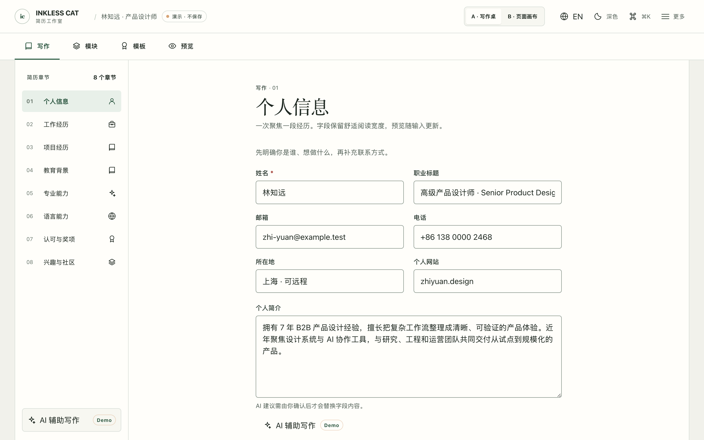
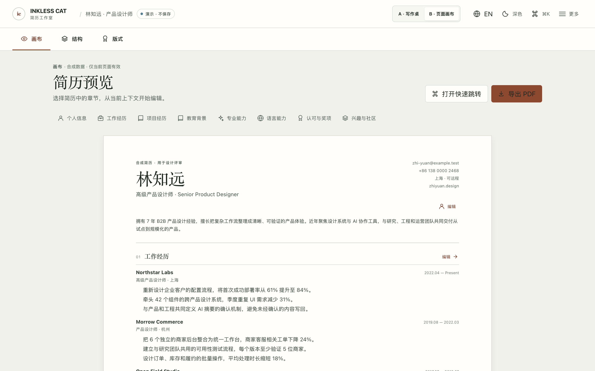
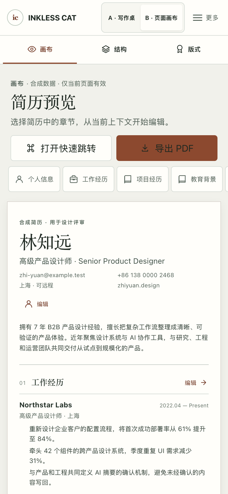

# Inkless-Cat V3 — D0 设计探索

状态：探索记录；最终方向由用户评审决定。
基线：`main`，`7eac5487caf25610f5edcaf87524027595cfc754`（GitHub compare `main` vs SHA：`identical`）。
分支：`codex/inkless-cat-v3-d0`；独立 worktree：`~/.codex/worktrees/inkless-cat-v3-d0/inkless-cat`。

## D0-A · 基线审计

### 当前体验观察

- 在线 `/` 的真实浏览器快照显示：手机将工具栏、编辑/预览切换、模块入口和长表单串在一个连续页面；进入经历或返回预览需要长距离滚动。编辑与预览在手机上分时显示，但导航和常用动作在首屏占据明显垂直空间。
- 生产页面提供内容编辑、模块开关/排序、模板、实时预览、导入导出、打印/PDF、AI 润色/生成、中英文、明暗主题和本地持久化。D0 仅演示设计工作流，不连接这些业务能力。
- 工程入口在 `src/main.tsx`：现有生产 `/` 和 Phase 4B 演示路由。编辑器通过 `useEditorPageController` 与正式 Resume/UI Store 对接；D0 不导入该 Controller、Store、实体模型、模板持久化或打印渲染器。

### 技术与工程约束

| 项目 | 已确认的基线 |
|---|---|
| React / React DOM | 19.3.1 |
| TypeScript | 5.9.3 lockfile 解析版本 |
| Vite / React 插件 | 8.3.5 / 6.1.2 |
| Tailwind CSS / Vite 插件 | 4.3.3 / 4.3.3 |
| Node / npm | `.nvmrc` 与 CI 为 Node 24.22.1；`packageManager` 为 npm 11.20.0 |
| 架构 | FSD aliases 已配置；新增路由放入 `src/pages/studio-v3-d0/`，UI 不向下层导入业务实体 |
| Tailwind 隔离风险 | `src/index.css` 中 Tailwind 4 显式扫描 `src/`，并同时导入打印样式。原型 JSX 不使用 Tailwind utility 类；V3 使用懒加载 CSS Module、`@reference` 和 `--studio-v3-*` 局部变量，不改 `src/index.css`、`@theme`、全局主题、基础控件或 `src/styles/print.css`。 |
| 路由与依赖隔离 | 仅在入口加入 `/design/v3-d0` 的 dynamic import；Motion、Base UI 和原型 CSS 只由该页面导入。生产首页初始资源以修改前构建记录对比。 |
| Node 环境 | 系统默认 Node 为 26.11.1，不符合项目 `24.x` 声明；本轮使用 Codex 提供的 Node 24.22.1 完成锁文件安装与后续验证。 |

### 并行设计工作的边界

GitHub 当前相关状态（只读核查）：

- PR #15：Open / Draft，Phase 4A Liquid Glass 多方向探索；保留其历史记录，不复用其视觉基线。
- PR #16：已合并，Phase 4B 独立演示进入当前基线；生产编辑器仍走 `/`。
- PR #17：Open / Draft，Phase 4C1 生产 Liquid Glass shell；不导入、不修改、不依赖其未合并代码。
- PR #18：Open / Draft，Mobile Compact Studio 2.0 M0；仅作为问题清单参考，不改其分支或沿用其布局。
- PR #17、#18 的 base SHA 均为本轮确认的 `main` SHA；本 D0 工作从该 SHA 独立开始。

### 可复核的设计问题

| 问题 | 当前证据 | V3 设计响应 |
|---|---|---|
| 手机编辑首屏高度被多层工具占用 | 线上手机浏览器可见全局工具栏 + 编辑/预览切换 + 编辑容器 + 模块入口后才到个人信息 | 将模式和当前任务合并成短导航；将模板、结构和 AI 放在当前任务可见的直接入口；字段用整屏编辑宽度 |
| 长表单靠滚动找章节 | 线上编辑表单在个人信息后继续按模块依序堆叠 | A 用章节目录与当前内容分区；B 以简历内容为目录和入口；两者都提供明确返回路径 |
| 预览与编辑在窄屏难并读 | 当前手机端通过切换“编辑器/实时预览”显示其中一面 | A 把预览作为独立校阅模式；B 以可读简历作为起始画布并通过上下文操作进入编辑 |
| 模板和模块入口是折叠区 | 线上页面以“展开模板/模块管理”按钮把入口放在长编辑流中 | 两方案将“结构”和“视觉”作为可发现的一级任务，并以合成内容演示选择及开关/排序 |
| AI 入口与普通表单的关系不清楚 | 线上 AI 创建与单字段润色入口并存 | 在用户当前段落旁提供润色入口；演示始终标记 Demo，不调用网络或读取密钥 |

## D0-B · 两套完整设计方向

两套方向使用同一份合成简历数据、短/长长度开关、同一断点与视口。布局、主要内容模型、导航、编辑起点和预览方式不同。Playwright Chromium 149 在 macOS 27.0.0 arm64、Node 24.22.1 下于 1440×900 PC 与 390×844 Mobile 生成同一初始长版 Fixture 截图；另提供 320×568、844×390 与编辑/管理视图截图。Direction A/B 可通过页眉切换，并可直接访问 `/design/v3-d0?direction=a` 或 `?direction=b`。

### Direction A · Draftbook / 写作桌

- **产品假设：** 用户正在写和检查自己的职业经历；当前章节内容应成为唯一焦点。
- **PC：** 顶部仅保留简历上下文、任务切换和保存状态。编辑模式为“章节目录 + 单一宽幅文稿区”；不常驻 A4 缩略图。预览切换为独立校阅画布；模板与模块切换为各自完整工作台。
- **Mobile：** 编辑从个人信息开始，章节通过可见的章节选择器切换。工作经历一次编辑一条，保留返回到原章节的路线；预览为可读的线性内容，模板和模块为独立任务屏。
- **AI：** 贴近当前摘要或成果字段，以“建议 → 用户确认采纳”的轻量侧栏/对话框呈现。
- **视觉：** 暖纸白、墨色、克制的森林绿；衬线用于简历标题，表单使用高可读无衬线体；水平分隔优先于卡片边界。
- **主要取舍：** 写作空间大、章节和长表单容易定位；查看改动对 A4 的影响需要切换到预览任务。

### Direction B · Pageboard / 页面画布

- **产品假设：** 用户先需要看清整份简历，再决定从哪一块开始改。
- **PC：** A4 阅读画布是入口，内容区块本身可作为导航。工具在顶部围绕“画布 / 结构 / 版式”组织；点击区块进入按上下文出现的编辑器，不保留固定表单栏。编辑器开合时保留页面位置。
- **Mobile：** 入口是重新排版为手机宽度的可读简历，不缩小 A4；点击章节后进入独立的全屏字段编辑，顶部“返回简历”带回原章节。结构和模板使用全屏工具视图，不压缩为 PC 侧栏。
- **AI：** 从当前简历段落触发，在其旁边/编辑视图中展示样例建议。
- **视觉：** 冷调工作台与暖白纸张形成清晰区分，炭色/陶土色作为交互标记；用页码、章节标记和基线建立画布感，不使用玻璃材质或渐变。
- **主要取舍：** 预览可读性和内容导航更强；直接编辑需要一次上下文转换，复杂字段在移动端需要进入编辑屏。

## 评审前的对比方法

| 维度 | Direction A · Draftbook | Direction B · Pageboard | 证据要求 |
|---|---|---|---|
| 信息架构 | “写作 / 模块 / 模板 / 预览”任务切换，左侧章节目录仅在编辑中出现 | “画布 / 结构 / 版式”，简历章节既是内容也是导航 | 两套 PC/Mobile 主界面与章节入口实测 |
| PC 编辑效率 | 当前章节字段始终在工作面；从目录切换经历不需开关弹层 | 直接编辑任意章节但先进入上下文编辑器，完成后关闭回画布 | Draftbook 三字段、经历编辑和返回；Pageboard 个人信息/经历弹层编辑 |
| PC 预览可读性 | 显式进入独立 A4 校阅模式；多一步切换换取写作区宽度 | 初始工作面即显示可读简历，画布占据主要视线 | 相同长版简历的 1440×900 截图；A4 校阅截图 |
| Mobile 首屏空间 | 章节选择器后立即进入字段表单，工具只占两条短导航 | 首屏优先呈现简历正文，页面纵向滚动；编辑需要打开全屏表单 | 390×844 和 320×568 截图；B 的 320px 姓名/摘要宽度断言 |
| Mobile 长表单编辑 | 章节菜单 + 单条经历选择；工作经历可以连续填写并回到原字段 | 全宽简历滚动 → 章节全屏编辑 → 返回时保存画布滚动位置 | 两方向移动端完整 journey，包含工作经历第 2 条与返回位置 |
| 模板/模块可发现性 | “模块 / 模板”是并列主任务 | “结构 / 版式”从画布工具栏切换 | 两方向都实际排序、显隐、选择模板；D0 本地新增模块/模板 |
| AI 融入方式 | 当前摘要/成果字段边直接触发，用户主动采纳 | 从画布选中章节后再触发样例建议，采纳后回到原画布上下文 | 两方向 AI loading / suggestion / apply；Draftbook 另测 error/retry |
| 视觉原创性 | 写作桌以暖纸面、林地绿和章节目录突出持续编辑 | Pageboard 以冷静画布、陶土色标记和页内章节入口突出简历页面 | 与 Phase 4B/M0 的章节内容表单/浮动 Dock 结构不同；见四张同条件截图 |
| 无障碍风险 | 章节目录与移动选择器是两种导航外观，需保持一致焦点顺序 | 画布热点增加 Tab 导航成本；上下文编辑器需焦点边界和恢复 | 键盘、对话框 Escape/关闭及触发器焦点恢复用例；44px 移动目标；对比度测量见 [Design System](design-system.md) |
| 性能与实现复杂度 | 单一表单面、直接绑定页面局部 Fixture，交互路径较短 | 同一 Fixture 需在简历画布和上下文编辑器间映射并恢复滚动 | 生产初始资源增量、V3 lazy chunks、切换耗时见 [验证报告](validation-report.md) |

设计权衡以已运行页面和端到端操作复核；截图目录包含每个方向 PC、Mobile、窄屏、横屏、预览及管理页。首屏差异是各方向有意的工作流假设，不用同一张式样图掩盖。

### 同视口截图

**Direction A · Draftbook** — 1440×900 与 390×844：

**Direction B · Pageboard** — 1440×900 与 390×844：

各方向的可复核页面证据：

- **A · PC：** [主写作区](evidence/direction-a-desktop.png)、[模块管理](evidence/direction-a-desktop-modules.png)、[模板管理](evidence/direction-a-desktop-templates.png)、[A4 预览](evidence/direction-a-desktop-preview.png)。
- **A · Mobile：** [个人信息](evidence/direction-a-mobile.png)、[模块管理](evidence/direction-a-mobile-modules.png)、[模板管理](evidence/direction-a-mobile-templates.png)、[320×568](evidence/direction-a-mobile-320.png)、[经历编辑](evidence/mobile-work-edit.png)。
- **B · PC：** [简历画布](evidence/direction-b-desktop.png)、[模块结构](evidence/direction-b-desktop-modules.png)、[模板版式](evidence/direction-b-desktop-templates.png)、[画布全景](evidence/direction-b-desktop-canvas.png)。
- **B · Mobile：** [简历画布](evidence/direction-b-mobile.png)、[经历编辑](evidence/direction-b-mobile-work-edit.png)、[模块结构](evidence/direction-b-mobile-modules.png)、[模板版式](evidence/direction-b-mobile-templates.png)、[320×568](evidence/direction-b-mobile-320.png)、[844×390 横屏](evidence/direction-b-landscape.png)。

所有截图由同一 Playwright Chromium 149 浏览器配置、同一条矩阵用例从 prototype 路由重建，保留在当前分支；GitHub Actions evidence artifact 包含 PNG、性能 JSON 与浏览器 test-results，artifact 名为 `inkless-cat-v3-d0-evidence`。

## D0-C · 暂定推荐

**暂定推荐：Direction A · Draftbook。** 当前主要创作行为是写入、整理和反复修订职业经历。A 的宽幅当前段落、章节目录、单条经历切换和 Mobile 字段直达减少了从内容到编辑的往返；整页 A4 预览仍可一键进入。它的代价是 PC/Mobile 用户在写作与校阅间切换，无法同时并读两者。Direction B 适合以作品呈现、章节检查和版式选择为中心的会话，且一打开便能检查整份简历；代价是每轮直接改字段多一次上下文编辑步骤。两套实现复用相同合成内容且通过各自核心旅程，推荐基于任务效率与实现复杂度的综合判断，**不是用户批准**。

完整结果见 [D0 验证报告](validation-report.md)。设计选择、未选方向保留及所有进入生产的决定仍由用户评审。
